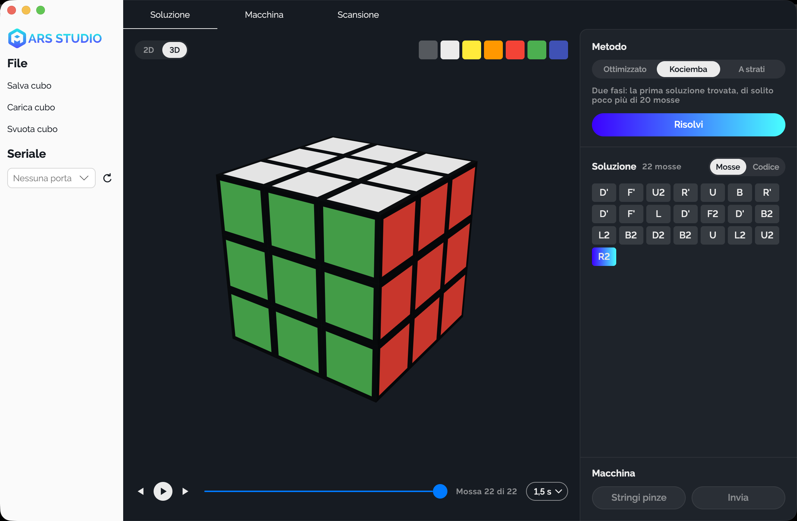
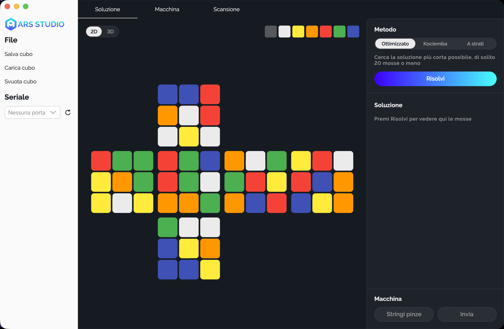
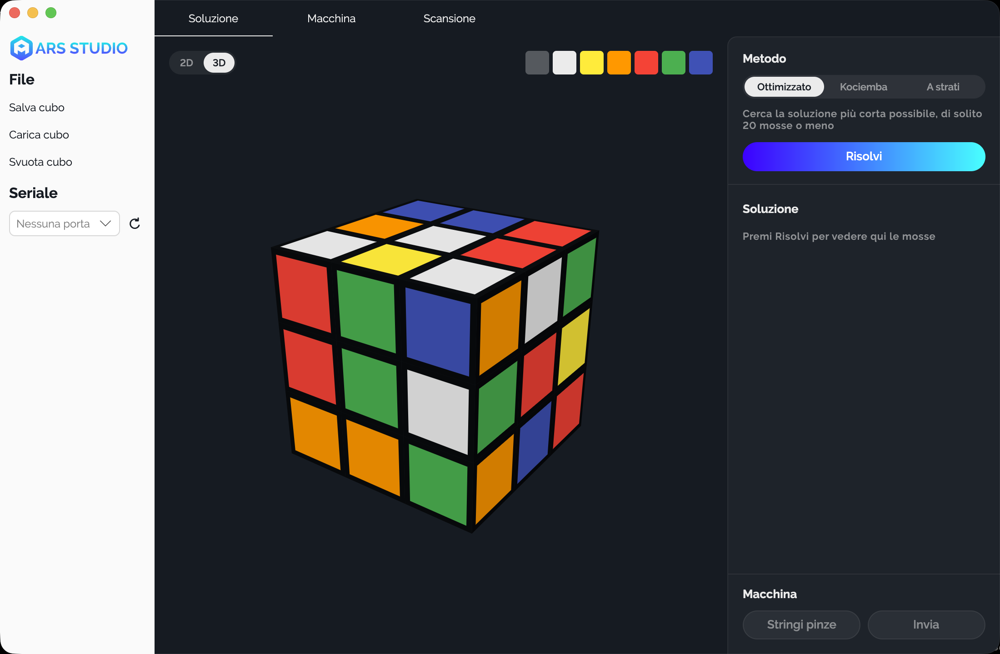
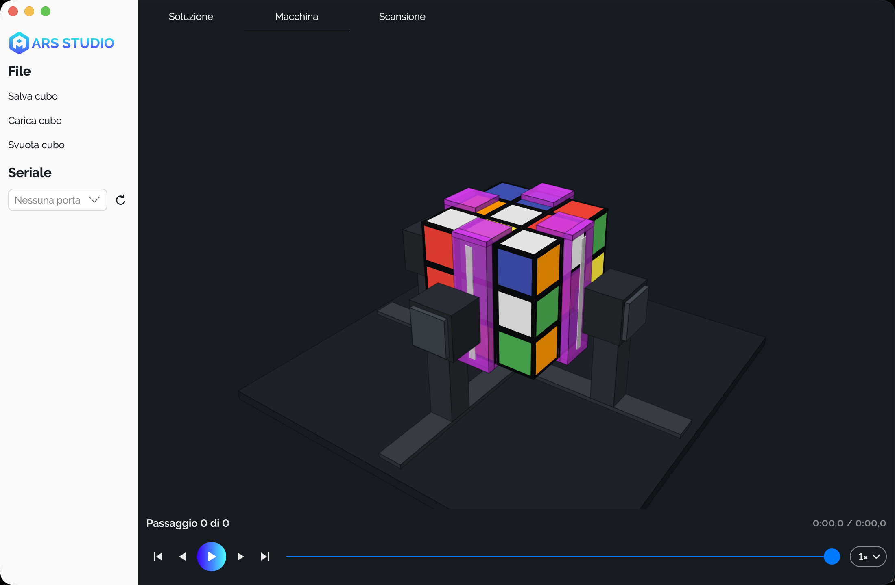

<p align="center">
  
</p>

<p align="center">
  Desktop app that scans, solves and animates a Rubik's cube, and drives the ARS solving machine over serial.
</p>

<p align="center">
  
  
  
  
</p>



## Features

- Set up the cube by hand on a 2D net or a 3D view, or load and save it as a `.cst` file.
- Scan the cube with a webcam: each face is detected and stored automatically while you show it to the camera.
- Invalid cubes are explained (missing colours, twisted corner, flipped edge, swapped pieces) instead of just rejected.
- Three solving methods, with a step-by-step animation of every move.
- 3D simulation of the ARS machine executing the solution, with timing.
- Sends the machine code to the hardware over a serial port.

## Solving methods

| Method | What it does | Typical length |
| --- | --- | --- |
| Optimized | Keeps searching for a shorter two-phase solution for 1.5 seconds | about 19 moves |
| Kociemba | First solution found by the two-phase algorithm | about 21 moves |
| Layers | Beginner method: cross, first layer, middle layer, last layer | about 120 moves |

Lengths are averages measured on random scrambles.

## Screenshots

| 2D net | 3D view |
| --- | --- |
|  |  |



## Getting started

Requires the [.NET 10 SDK](https://dotnet.microsoft.com/download).

```sh
git clone https://github.com/xm1k3/ars-project.git
cd ars-project
dotnet run --project src/ArsStudio
```

Run the tests:

```sh
dotnet test ArsStudio.slnx
```

Development and testing happen on macOS. Windows and Linux are supported by the code but have not been verified yet.

## Usage

1. Pick a colour from the palette (keys `1` to `6`, `0` for empty) and click the stickers, or open the Scan tab and show each face to the camera.
2. Choose a method and press **Risolvi**.
3. Step through the moves with the arrow keys, or open the Machine tab to watch the machine do it.
4. With the machine connected, select its serial port and press **Invia**.

## Project layout

| Path | Content |
| --- | --- |
| `src/ArsStudio` | Avalonia application |
| `src/ArsStudio.Core` | Cube model, solvers, scanning and machine logic |
| `src/TwoPhaseSolver` | C# implementation of Kociemba's two-phase algorithm |
| `tests/ArsStudio.Core.Tests` | Unit tests |

## License

ARS Studio is distributed under the [MIT License](LICENSE).
